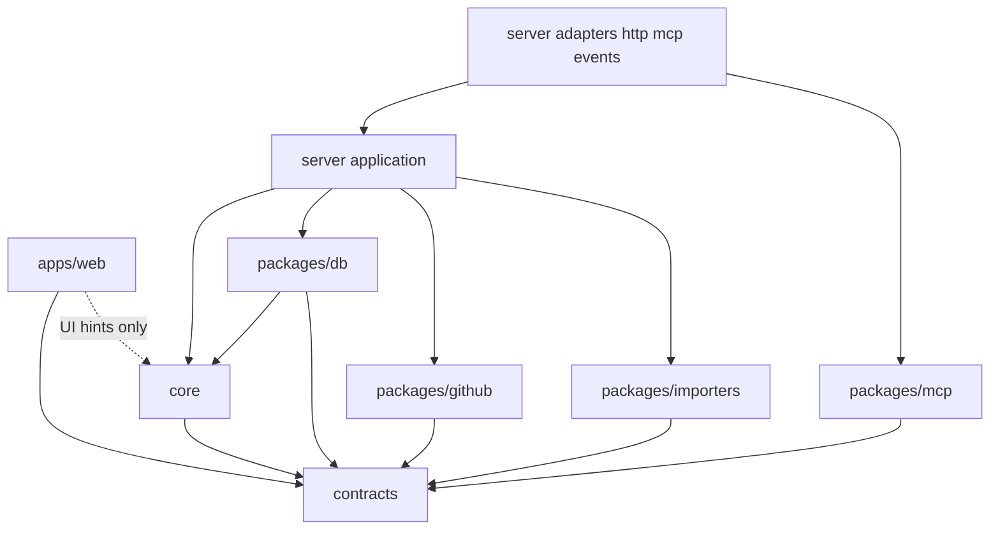
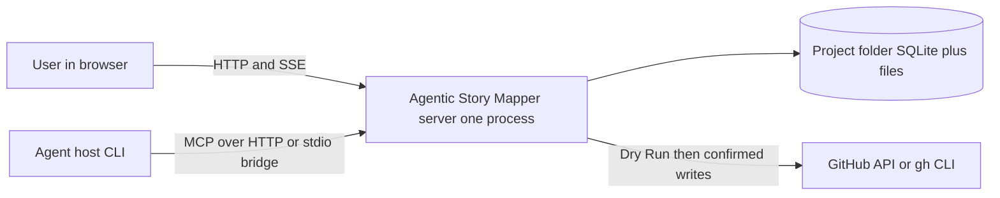
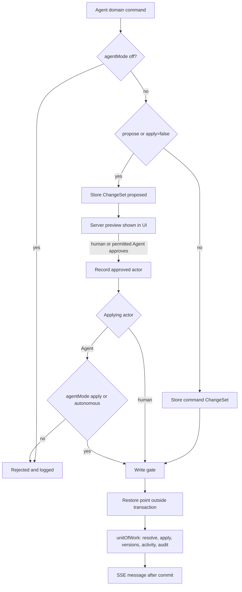
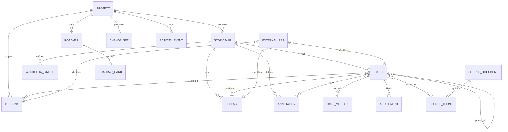

# Architecture Spine — Agentic Story Mapper

Reproducing statement: Record the exact frozen dependency versions after the sequential Story 8.2 upgrade wave, retaining existing architecture decisions. Date: 2026-10-20. Version: 8. Changelog: Updated the Stack to the installed and verified graph.

## Design Paradigm

Hexagonal modular monolith. One server process owns all state; the web UI, MCP hosts and GitHub sit at its edges. `packages/contracts` (Zod) is the kernel every layer shares.

| Layer | Location | Role |
| --- | --- | --- |
| Kernel | `packages/contracts` | Zod schemas, error codes, operation union, ids and formats |
| Domain | `packages/core` | Pure functions: hierarchy, operation registry (`describe`, `resolve`), slicing, coverage, health, proposals, provider interfaces |
| Persistence adapter | `packages/db` | Migrations, unit of work, one repository per aggregate, snapshots; the only place with SQL |
| Driven adapters | `packages/github`, `packages/importers` | GitHub work items; Markdown and TXT parsing |
| Tool definitions | `packages/mcp` | MCP tool names and input schemas only |
| Application | `apps/server/src/application` | Use cases, one file each, grouped by aggregate |
| Driving adapters | `apps/server/src/adapters/{http,mcp,events}` | Validate, resolve actor, call a use case, map errors |
| Client | `apps/web` | React UI over HTTP and SSE |



## Invariants & Rules

### AD-1 — Dependency direction and purity are rules
- **Binds:** all, NFR-7
- **Prevents:** logic drifting into adapters, cycles, hidden imports, nondeterministic domain code
- **Rule:** Imports follow the diagram only. Every workspace import is declared in the importing package's `package.json`; a repository script compares non-test imports with declarations and usage (tool-only dependencies such as `drizzle-kit` and Vitest are on its allow list) and fails CI. Packages import each other through their package entry, never through source paths. Only `packages/db` may import `better-sqlite3` or `drizzle-orm`. `core` imports no `node:*` module and calls no `Date`, `Math.random` or `crypto`; a `Clock` and an `IdSource` are injected. A web feature imports another feature only through its `index.ts`; cross-feature components live in `apps/web/src/components`. `[ADOPTED]` for `core` purity and `db` as the only SQL place.

### AD-2 — One use-case layer serves HTTP and MCP
- **Binds:** FR-30, FR-32, FR-33, NFR-3
- **Prevents:** duplicated handler logic, MCP and UI capability drift, permission checks in one adapter only
- **Rule:** Every capability that reads or changes Story Map data is one application use case with typed input and output from contracts and a required `ActorContext`. Each use case file exports a descriptor `{name, kind: read | write | human-only, tool?, route?}`. The capability manifest is generated by scanning `application/**`. The parity test fails on an exported use case without a descriptor, on a `write` use case without an operation registry member (AD-5) or a tool, and on a route or tool that resolves to no descriptor. HTTP routes and MCP tools only validate, resolve the actor, call the use case and map errors.

### AD-3 — Unit of work and one write gate
- **Binds:** FR-33, FR-47, NFR-4
- **Prevents:** partial writes, unaudited changes, events for rolled-back work, two transaction styles
- **Rule:** All mutations run through `unitOfWork.run(actorContext, fn)` in `packages/db`. `fn` is synchronous, receives `Tx`-bound repositories and performs no I/O other than SQLite. Repository write methods are reachable only through `Tx`; a repository built from the root handle exposes reads only. `actorContext` (actor type, actor id or MCP host, MCP session id) is required everywhere; repository code never defaults an actor. Reads that inform a write, the base-version check and the reading of `agentAccess` and `agentProtection` happen inside `fn`. Network I/O happens before (planning) or after (recording) the transaction. A use case with external side effects writes a `planned` row per item, performs the effect, then records the result per item in a further transaction. One in-process write gate serializes every `unitOfWork.run`, snapshot and restore. The transaction writes the change, a Card Version where a Card changed and an Activity Event; stream events are emitted after commit. A test fails when a mutating repository method runs without an active `Tx`. A ChangeSet apply writes one Activity Event per operation plus one `changeset.applied` event; any other use case writes one event per changed object.

For file-coupled operations, validate/prepare content before the applying transaction. SQLite rows, versions/history, operation Activity and successful mutation audit commit atomically. Preparation failure changes no domain data; SQLite failure leaves no visible document/attachment links and any retained prepared-file effects are reported explicitly. Filesystem and remote effects are not claimed rolled back by SQLite. This is the Epic 4 user-approved boundary (2026-10-10), recorded in `docs/adr/0003-changeset-file-and-remote-effect-boundary.md`.

### AD-4 — Non-human mutations are ChangeSets
- **Binds:** FR-31, FR-51 to FR-54, FR-56, FR-27
- **Prevents:** a second write path for agents or importers, preview that differs from apply, duplicates on re-runs
- **Rule:** Any mutation of Story Map data whose actor is not `human` (agent tools, the local half of GitHub import and pull-sync, importers) is a ChangeSet handed to one executor. A newly generated command with `apply=true` without protection: persist the ChangeSet and its proposing actor, restore point, then one separately audited atomic apply, without requiring prior human approval. An already stored proposal requires approval under the Project policy, human-only by default; `allowAgentApproval` may explicitly authorize Agent approvers; proposal generators never auto-apply. `apply=false` or protection on: stored as `proposed`; proposals never create a restore point, the first apply of an MCP session does. Operations address objects by id, by external reference or by a ChangeSet-local reference. Preview is computed only on the server against database state (`GET /api/changesets/:id/preview` and `apply=false` replies); the web renders it and never computes it. Operations apply in array order; dependents of an operation are every later operation that references its local id or addresses the same entity or a descendant, and they are deselected with it. Two proposals touching the same external reference are flagged at proposal time. All incoming GitHub domain changes, including human-triggered import/pull and remote-wins resolution, use actor `github` ChangeSets with retained initiating identity. GitHub push/outgoing sync/local-wins resolution are not SQLite ChangeSets: every remote effect uses one persisted immutable Dry Run with explicit Issue/Milestone items and human UI confirmation by plan id; `confirm:true` with a recomputed selection is insufficient. Revalidate local/remote fingerprints, connection/mapping and epoch; stale plans require re-review. Push writes only adapter link/sync/intent/outcome bookkeeping, never Card fields. Agent approval cannot authorize remote effects. A version conflict aborts the operation, a sync conflict is persisted and blocks the field until resolved, and both are reported as one `ConflictReport`.

### AD-5 — Operation registry
- **Binds:** FR-30, FR-31, FR-53, FR-56
- **Prevents:** tools that bypass ChangeSets because no operation exists, preview and apply drifting apart, hierarchy rules in two places
- **Rule:** `ChangeOperation` is a discriminated union on `(op, entity)` in contracts with a typed payload per member; `z.unknown()` payloads are forbidden. Each member has exactly one handler pair in `core`: `describe(snapshot, op)` for preview and `resolve(snapshot, op)` returning the resulting entity changes (pure; positions and hierarchy validation included). `packages/db` persists resolved changes only and holds no operation semantics and no second hierarchy check. The union covers every entity a tool may write: Story Map, Card, Release, Persona, Roadmap and children, Annotation, Workflow Status, Story Template, Product Context, links, dependencies, attachments, park and unarchive, external reference set and unset, bulk status by external reference, reorder, delete with child strategy. External-reference upserts are stored as `upsert` and resolved to create or update inside the applying transaction; preview shows the current resolution marked "may change". Preview shows placeholder keys `NEW-1..n`; real Card Keys are assigned in the applying transaction. Every `change_sets` row carries `operationsSchemaVersion`; a migration changing the operation schema marks incompatible pending rows, including approved rows, `stale`. Applied history is retained. Schema-stale rows require current-schema resubmission and fresh approval, not partial execution.

### AD-6 — Agent access, protection and approval
- **Binds:** FR-32, FR-36, NFR-3
- **Prevents:** unauthorized Agent approval, inconsistent flag reads, and an overclaimed security model
- **Rule:** The Agent mode is a guardrail against a cooperative agent using the tool surface, not a security boundary against a local process; this statement appears in the Agent panel and the README. The actor is `agent` iff the request arrived on `/mcp` or `/api/mcp/call`; every other route is `human`. Project settings hold `agentMode` (`off`, `propose`, `apply` default, `autonomous`; ADR 0010) and `github` (default off). With `agentMode=off`, `/mcp` and agent calls are rejected. With `agentMode=propose`, every domain-writing tool behaves as `apply=false`. A human may approve its own UI proposal. Approval is human-only unless `agentMode=autonomous` permits the guarded `ApproveChangeSet` Agent capability. Rejection, restore and all settings remain human-only. Approval is a lifecycle action, not a recursive ChangeSet operation. The approving transaction validates real Project ownership and the current Agent mode, and records actual `proposedBy`/`approvedBy` actor type/id/host/session without trusting caller claims. With `agentMode=autonomous`, Agents may approve their own or another actor's proposals. Agent `ApplyChangeSet` requires a previously approved proposal (human or Agent authorized at approval time) and a current Agent mode of `apply` or `autonomous`. Human apply remains allowed in every mode. Leaving `autonomous` blocks subsequent Agent approval transactions without erasing prior approval records. This policy is recorded in `docs/adr/0010-single-agent-mode.md` (superseding 0004). Flags are read inside the applying transaction. Tool calls in flight when a flag flips or a restore starts are settled by the write gate. Every tool call, reads included, is recorded with host, session, tool name, input hash, output hash, outcome and affected ids, so the audit area can filter by tool. A rejected call and every change to a flag create an Activity Event. The current flag state is shown in the app header on every page together with the notice that an enabled agent may forward retrieved context to its own provider. GitHub import and pull-sync route their local domain changes through ChangeSets; under protection they store a proposal and perform no local domain apply. GitHub push remains refused as `protected` under protection, outside the SQLite ChangeSet array, with its Dry Run confirmed only by a human in the UI. Disabled GitHub access refuses planning/provider calls except a specifically consented human connection verification under ADR 0008 D1; that verification saves nothing, does not enable the flag and tells the user normal import/sync/push remain blocked. Final Connect explicitly enables with audit. MCP/background calls have no exception. Permissions/scope/epoch are rechecked after provider awaits. Restore, snapshot on demand and archive import are human-only. There is no stored privacy mode and no Strict Local label. A per-launch nonce is available if a boundary is later wanted (Deferred).

### AD-7 — Versions and optimistic concurrency
- **Binds:** FR-31, FR-47, FR-50, NFR-4
- **Prevents:** silent overwrite between a human and an agent, seven readings of "version"
- **Rule:** Versioned roots are Story Map, Card, Release, Persona and Roadmap (AD-17). A root's `version` increases by exactly 1 in the transaction that changes the root row or any owned child row or link. Sibling reordering bumps only the moved Card. Foreign-key cascades never touch versioned roots; `ON DELETE SET NULL` or `CASCADE` to or from a root is replaced by explicit use-case code that bumps versions. Story Map `version` changes only on Story Map fields. `card_versions.version` equals `cards.version`, unique `(card_id, version)`. Commands carry `baseVersion`; it is checked once per object against the state before the ChangeSet starts. A conflict returns HTTP 409 `{code: "conflict", conflicts[]}` listing every conflicting operation; nothing is applied partially and the user deselects and resubmits. `baseUpdatedAt` is removed from contracts. Children without their own version are protected by their root. Clients send the version returned by their previous save; every accepted Card save increases `cards.version`, and a save by the same actor within 60 seconds of the latest Card Version rewrites that history row under the new version instead of adding one (version numbers in history may have gaps; ADR 0002). Customization lists (Annotations, Workflow Statuses, Story Templates) are last-write-wins by design. A Workflow Status rename or deletion/replacement that changes Cards still validates all affected Card base versions and updates them atomically in the effective project/map scope. Cards store status names: resolve the selected definition and scope before collecting affected Cards; refuse ambiguous same-name ownership or an invalid replacement without partial writes. Persona/Annotation unlinking similarly preserves owned-root version/history/audit rules; deleting a copied Story Template never rewrites Card descriptions.

### AD-8 — Restore points and the restore protocol
- **Binds:** FR-44, FR-46, NFR-4
- **Prevents:** unrecoverable agent mistakes, a restore that corrupts the project or erases its own record
- **Rule:** Snapshots use `VACUUM INTO` a temporary file that is renamed on success, taken by the write gate outside any transaction, before every ChangeSet apply, before every migration, at the first apply of an MCP session and on demand. A single successful pre-apply snapshot satisfies both the per-apply and first-session-apply requirements; proposals and empty selections create none. Classes are `pre-migration`, `pre-restore`, `pre-apply` and `manual`; retention keeps the newest N per class, always pins the newest `pre-migration` and `pre-restore` until a later one succeeds, and the size cap never deletes the last snapshot of a class. File names carry the schema version. `snapshots/` is git-ignored by a file inside it. Restore is one human-only use case: (1) validate before touching anything: `PRAGMA integrity_check` and a schema version not newer than the application, else refuse; (2) reject new requests with 503 and wait for in-flight use cases; (3) take the pre-restore snapshot; (4) close the connection, copy the snapshot to `storymapper.sqlite.restoring`, delete `-wal` and `-shm`, rename over the database; (5) reopen through a `DatabaseHandle` holder that repositories dereference per call, then migrate forward; (6) copy `activity_events` and `change_sets` rows newer than the snapshot into the restored database flagged `undone_by_restore`; (7) emit `project.restored` with a new epoch. A leftover `.restoring` file at startup is completed or rolled back deterministically. Restore never touches remote systems and never deletes attachments; its result lists GitHub links created after the snapshot. Inverse operations per session are deferred.

### AD-9 — Versioned migrations only
- **Binds:** FR-2, FR-44
- **Prevents:** schema drift between installs, data loss in table rebuilds, unreadable stored JSON
- **Rule:** Until the first tagged release schema changes are made in place and development databases are disposable; the baseline migration is created in Story 8.1 when v1.0 is prepared and captures the schema as it stands then. Epic 6 follows this existing pre-release path (decision 8A): keep runtime bootstrap/opening in `packages/db/src/connection.ts` consistent with Drizzle schema declarations, including the required Card indexes; test populated fixtures, reopening and current-schema Restore/integrity. Do not introduce a second schema mechanism, a migration framework or legacy compatibility within Epic 6. From that baseline on, schema changes are `drizzle-kit` generated SQL in `packages/db/migrations`, applied at open after a pre-migration snapshot; data backfills use `drizzle-kit generate --custom`; hand-written DDL and inline `ALTER` are forbidden. Every migration runs with `foreign_keys=OFF` outside the migrator transaction, followed by `PRAGMA foreign_key_check` and abort on any violation. CI runs each migration against a populated fixture database of the previous schema and asserts row counts per table. The migrator alone does not detect a newer schema, so a pre-check refuses a database whose schema is newer than the application, and one with tables but no migration journal, with instructions naming the manual recovery. Every JSON-bearing column has a `schemaVersion` sibling and readers use versioned parsers. `redactedTables` is exported from `packages/db` beside the schema; the classification test (AD-17) fails on an unclassified table. The archive manifest carries `formatVersion`, `schemaVersion` and the application version read from `package.json`; an unsupported format version fails naming the supported versions. The archive contains the redacted database snapshot, `documents/`, `attachments/` and `exports/`, and excludes `snapshots/`, `logs/`, `.lock` and `.port`. Projects created by prototype builds are not migrated.

### AD-10 — External references
- **Binds:** FR-52, FR-54, FR-56
- **Prevents:** duplicates on re-import, orphaned references, two identity stores for GitHub issues
- **Rule:** `external_refs(id, entity_type, entity_id, system, external_id, scope_id NOT NULL, synced_version, created_at)` where `scope_id` is the Story Map id, or the Project id for project-level entities. Unique `(scope_id, entity_type, system, external_id)` and unique `(entity_type, entity_id, system)`. `system` `github` is reserved and written only by the validated GitHub adapter, including internal executor operations; a caller-provided source string cannot grant that authority. Canonical normalized HTTPS Issue/Milestone locators include repository and number. GitHub links move into this table; `remote_work_item_links` keeps connection association and sync baselines/state keyed by `external_refs.id`, without duplicate entity/remote/URL identity. Generic external-ref setters still reject `github`; agent systems match `[a-z0-9-]+`. `external_id` is trimmed and case-sensitive; the recipe defines it. The use case that deletes an entity deletes its references in the same transaction; archive keeps them. An upsert onto an archived entity resolves to `update` plus an implicit `unarchive` shown in the preview. A Card cannot change Story Map; a cross-map move is copy plus archive. Source-only GitHub evidence cites canonical refs without granting outbound ownership; copy preserves provenance, not a second active sync binding. Explicit deletion updates surviving evidence-owner root versions/history/audit and records typed `externalRef.deleted` Activity evidence (reason `entity-deleted`, Project/Map/entity identity and canonical before snapshot) for local-deleted health before removing live refs. Health reads non-undone scoped events without a current equivalent live binding; detach/rebind/park/archive are not entity deletion and no tombstone table is added. This history cannot resolve/recreate live entities. Archive redaction removes only GitHub refs and related Sync/evidence/payloads while retaining non-GitHub Agent refs/baselines. Current-schema Restore uses canonical refs; AD-9 does not promise old prototype migration. `synced_version` holds the entity's version after the agent's last apply; an upsert carries no base version and the executor uses `synced_version` as its base, so a human edit since the last sync surfaces as a conflict instead of being overwritten.

### AD-11 — Live updates: ordered SSE
- **Binds:** FR-53, UJ-3, UJ-7
- **Prevents:** stale boards, lost or replayed events, editors reset under the typing user
- **Rule:** `activity_events.seq` is an integer autoincrement assigned inside the transaction; the SSE `id` is `<epoch>:<seq>`. `epoch` is created with the database and regenerated by restore; a client with another epoch receives `reset` and refetches. One message per transaction lists `{entityType, entityId, version}` tuples and the `originClientId` sent by the web app in a header on every mutating request. Events never carry content. The web app ignores its own origin for editors holding unsaved state, coalesces invalidations over 100 ms and keeps one stream per browser profile (BroadcastChannel leader). The stream sends a heartbeat every 15 seconds and closes on shutdown. The web app does not poll. The what-changed panel reads Activity Events after the client's last-seen `seq`, stored client-side per project.

### AD-12 — Process model, exclusivity and operations
- **Binds:** FR-1, FR-4, FR-34, NFR-6
- **Prevents:** a second writer, two-origin drift, silent operational failure
- **Rule:** One server process serves the built web app, `/api`, `/api/events` and `/mcp` (Streamable HTTP with stateful sessions) on one loopback port. The server takes an exclusive lock on `<project>/.lock` (PID, start time) before opening the database and refuses to start when it is held; other tools use the HTTP API only and no script opens the SQLite file for writing. `busy_timeout` and WAL auto-checkpoint are set. Work expected to exceed 100 ms of synchronous time runs on a worker thread with its own read-only connection or is chunked where ChangeSet atomicity allows. The stdio bridge script holds one piece of state, the `Mcp-Session-Id`, forwards it and re-initializes on a 404; agent actor events require a session id. Push records an intent row per Issue/Milestone before every modifying call, persists successful outcomes before the next effect and reconciles a stable entity marker on explicit resume/re-push after Restore. The machine footer preserves authored Markdown, names Story Map/Card Key and links to the current loopback Card route. A partial/failed/uncertain marker lookup never authorizes blind recreation; remote effects are not rolled back by SQLite. Milestone effects must not be hidden inside an Issue provider call. Logs go to `<project>/logs/` with size rotation. `GET /api/health` returns version, schema version, epoch, write gate state and pending migration; `doctor` calls it. The server writes `<project>/.port` at start; the bridge, `doctor` and generated host configs read it. Shutdown order: stop accepting, drain, close SSE, checkpoint, close. Vite with a proxy exists for contributors only. The server binds loopback; binding elsewhere needs `STORYMAPPER_ALLOW_REMOTE_HOST=true` and logs a warning.

### AD-13 — Host and Origin validation on every route
- **Binds:** FR-1, FR-34, NFR-3
- **Prevents:** CSRF and DNS rebinding against a local server (the MCP SDK leaves protection off by default)
- **Rule:** One hook rejects any request whose `Host` is not a loopback name with the served port and any request with a present `Origin` that is not the served origin. Requests without `Origin` pass. Mutating requests require a JSON content type, except multipart upload routes and `DELETE /mcp`, which require the Origin check only. `GET /api/events` requires `Accept: text/event-stream`. There is no token: same-user local processes are trusted, other local OS users are out of scope. `[ADOPTED]`

### AD-14 — Secrets stay outside the Project
- **Binds:** FR-3, FR-26, NFR-3
- **Prevents:** tokens in archives, logs, snapshots or Activity Events
- **Rule:** Credentials live in `credentials.json` in a user-level directory (Windows `%APPDATA%/StoryMapper`, otherwise `~/.config/storymapper`, mode 0600 on POSIX), unencrypted by design and atomically replaced. One app resolver selects authenticated CLI → user file → environment; missing sources advance, malformed/unreadable selected sources or rejected credentials fail visibly without silent account switching. Actual CLI/provider identity must match selected source despite subprocess environment. The CLI method stores nothing in Agentic Story Mapper; login is guided in the user's own terminal with Recheck, not app-managed. Credential-status reads are local configured-source probes, not network-backed CLI authentication checks while off. Candidate token verification is in-memory; final persistence is human-only, outside Project/SQLite/Activity. Cross-file/DB failure reports retained file effects truthfully. Archives redact by the exported `redactedTables`. A test asserts no secret value appears in logs, events or archives. `[ADOPTED]`

### AD-15 — Providers behind two interfaces
- **Binds:** FR-1, FR-26 to FR-29, FR-55, NFR-2
- **Prevents:** provider logic in routes, a provider id known in three places, hidden outbound traffic
- **Rule:** `WorkItemProvider` (`packages/github/src/providers/work-item-provider.ts`, GitHub implementation in `github-provider.ts`) and `PublishProvider` (`packages/core/src/publishing/publish-provider.ts`, no implementation) are the only seams to external systems. Registration is in `packages/github/src/providers/index.ts`, paired credential status/auth registration in `apps/server/src/services/credentials.ts` and the provider enum in `packages/contracts/src/schemas/work-item-provider.ts` (re-exported by `schemas/domain.ts`). Immutable own-key registries must exactly match that enum; unknown runtime ids fail before handlers or factory effects. GitHub remains the only shipped enum member. The contracts identity boundary (`schemas/work-item-identity.ts`) validates provider, owner/repository, Issue/Milestone kind, remote id/number and HTTPS URL. GitHub retains strict canonical URL locators. Other adapters store one strict canonical serialized identity in `external_refs.external_id`; its URL occurs once, and sync rows retain only the canonical ref plus connection/state/baselines. Shared orchestration, source/provenance, conflict, health, copy, deletion, Restore and portable-redaction paths consume that normalized identity; generic ref writes reserve every registered provider. A new adapter module requires only those three integration sites; an isolated test-only provider must exercise shared application import/conflict/confirmed-plan paths without changing GitHub implementation/tests or shared orchestration. Unknown ids fail explicitly before side effects and test providers do not ship. A provider id is a member of the contracts enum, of one registry and of credential resolution; a test proves the registry rejects an unknown id. GitHub writes require a confirmed Dry Run. The GitHub connection dialog enables the `github` flag explicitly and logs it. With `github` off and no agent connected the process makes no outbound request except an explicitly consented human candidate verification under ADR 0008 D1: no background check, update check, telemetry or remote assets; a network-stub test asserts both ordinary refusal and the narrow exception. Accepted D2 imports new Cards Unscheduled, retaining hierarchy/source/type; only explicit later sync proposes Release assignment. Baselines distinguish initial null placement from deliberate Milestone removal. D3 read-only forbids outbound writes but protects local divergence using ordinary three-way conflicts. D5 maps Card levels to actual native Issue types in connection settings and preserves imported types; invalid mapping blocks writes. D6 synchronizes status/opted-in Annotation labels while preserving unrelated remote labels. Effective existing scoped Annotation names supply that mapping; refuse ambiguous definitions, synchronize assignments without deleting definitions and do not auto-create unknown remote labels as Annotations. Release/Milestone identity survives rename, explicit effects map name/goal/releaseDate/released state and iteration stays inbound-only. Provider auth/network/rate-limit/partial-response failures are explicit, never inferred deletion. One unresolved canonical-ref/field conflict retains reviewed evidence and only resolves after a successful explicit field decision; health uses the same canonical baseline and deletion evidence without provider I/O. See `docs/adr/0008-epic-7-github-connection-and-sync-policy.md`.

### AD-16 — Contracts and errors
- **Binds:** all
- **Prevents:** duplicate types, two error mappings, drifting error shapes
- **Rule:** API, MCP inputs and UI types derive from the Zod schemas in `packages/contracts`. Use cases throw only typed `DomainError(code, details)`; codes are enumerated in contracts with their HTTP status. One function `toErrorResponse(error)` serves HTTP and MCP; an unknown error is a 500 `internal` with a logged id and no message leakage. Multi-step failures (push, import) return a per-item result array, never one throw. `[ADOPTED]` for Zod as the single source.

### AD-17 — Aggregate register
- **Binds:** FR-2, FR-46, FR-47, FR-52
- **Prevents:** shared children with two owners, unversioned tables, unredacted new tables
- **Rule:** Every table belongs to one row below; a schema-classification test fails on an unclassified table and feeds `redactedTables`. A link table belongs to the aggregate that renders it and bumps that root.

| Aggregate | Root and owned tables | Repository | Versioned | ChangeSet entity | External ref |
| --- | --- | --- | --- | --- | --- |
| Project | `projects`, `project_settings` | projects | no | none (human-only) | no |
| Story Map | `story_maps`, `product_contexts` | story-maps | yes | storyMap, productContext | yes |
| Card | `cards`, `card_personas`, `card_annotations`, `card_attachments`, `card_source_links`, `card_dependencies`, `card_versions` | cards | yes | card, links, dependency, attachments | yes |
| Release | `releases` | releases | yes | release | yes |
| Persona | `personas` (Project or Story Map scope) | personas | yes | persona | yes |
| Roadmap | `roadmaps`, `roadmap_columns`, `roadmap_swimlanes`, `roadmap_cards`, `roadmap_references` | roadmaps | yes | roadmap and children | no |
| Customization | `annotations`, `workflow_statuses`, `story_templates`, `ai_function_templates`, `view_settings` | customization | no | annotation, workflowStatus, storyTemplate, aiTemplate, viewSettings | no |
| Source | `source_documents`, `source_chunks` | sources | no | sourceDocument | no |
| Sync | `connector_connections`, `remote_work_item_links`, `card_github_evidence`, `sync_runs`, `sync_conflicts`; Epic 7 plan/intent/outcome records | sync | no (owned displayed evidence bumps its root) | adapter ref/sync/evidence operations; remote effects outside ChangeSets | `github` in canonical `external_refs` |
| ChangeSet | `change_sets` | changesets | no | none | no |
| Activity | `activity_events` | activity | no | none | no |
| References | `external_refs` | written by the owning aggregate's use case | no | reference set and unset | n/a |

Epic 7 target: remove `github_links` in 7.3, re-key sync/evidence to canonical refs, and classify/redact new plan/intent/outcome records in 7.4 (exact names fixed in dev step 02). Current executable classification remains in `packages/db/src/schema/classification.ts` until those stories are implemented. Shared `external_refs` need row-level GitHub redaction, not deletion of all reference systems.

### AD-18 — Performance measurement and budget scope
- **Binds:** NFR-1, FR-10
- **Prevents:** unmeasured large-map regressions, hidden timing waivers, O(n squared) key allocation
- **Rule:** On the 1,000-Card fixture record map read, committed single-Card mutation, board interaction and search/filter latency with raw samples, fixture/environment identity, cold/warm context and explicit measured boundaries. The reference values are 150/30/100/300 ms respectively. For Epic 6 these are diagnostic only: there is no timing-based acceptance/CI failure or derived 2x gate; binding gates need a separate later decision (9C, 2026-10-17). Existing earlier-story gates, including 200-operation Apply <= 2 s and Restore point <= 1 s, remain as previously specified, with their own CI tolerance and historical failures/accepted exceptions retained. Accessibility and functional checks still fail on defects. Add `cards.story_map_id` and `cards.parent_id` indexes through the current AD-9 schema path; preserve existing external-ref and Activity indexes. Card Key allocation uses `story_maps.next_card_number`, never a remaining-Card scan; keys are never reused. Search and filters operate over the cached map snapshot; measurements alone do not authorize a new server search endpoint. ETags, `If-None-Match`, aggregate cache revisions and client 304 handling are deferred beyond Epic 6 (7C); keep existing full snapshot reads and live invalidation. They are not prerequisites for completing this epic. Accepted scope: `docs/adr/0007-epic-6-board-scope-and-diagnostic-performance.md`.

### AD-19 — Size limits are enforced
- **Binds:** NFR-7, NFR-8
- **Prevents:** the 3,797-line repository and 1,405-line routes file recurring
- **Rule:** Source files stay at or below 750 lines and 100 KB, functions at or below 50 lines. Repositories follow AD-17. A CI script fails on a violation. Every package that contains logic has tests; CI reports coverage per package and fails a package below 60 percent line coverage, a floor that only rises.

### AD-20 — Web architecture
- **Binds:** FR-8, FR-9, FR-13 to FR-16, FR-7, FR-53, NFR-5
- **Prevents:** server data cached in two places, hard-coded UI text, editors flooding the history
- **Rule:** TanStack Query holds server state, Zustand holds UI-local state only, routes are code-based TanStack Router routes, one page component per View sharing components, Card descriptions are Markdown strings (Tiptap with Markdown serialization), and all UI text comes from one string module. The editor batches saves at most every 2 seconds. Every drag-and-drop action has a keyboard path and a form path that call the same use case; role labels come from the string module and never from color alone; interactive elements carry accessible names. The `web -> core` edge is limited to UI hints such as drag validity that are never authoritative. `[ADOPTED]` for routing, views and Markdown.

### AD-21 — Runtime and install
- **Binds:** FR-4, FR-5, NFR-6
- **Prevents:** a PowerShell-only path, machine-local runtimes
- **Rule:** Node 24 and Corepack are the only prerequisites; `engines` states an upper bound while Corepack ships with Node. `scripts/*.mjs` provide `setup`, `start` (builds the web app if missing, starts the server, opens the browser), `dev` and `doctor`. `setup` needs no configuration file: environment variables are optional overrides and secrets live in the user-level file. `doctor` is read-only and reports pass or fail per check (Node version, port free, native module loads, dependencies installed) with a named fix. There is no repo-local Node and no OS-specific script in the core path. Paths use `node:path`. Line endings are LF via `.gitattributes`.

### AD-22 — Dependency hygiene and currency
- **Binds:** NFR-3, FR-42, FR-43
- **Prevents:** shipping known advisories, unused or risky packages, an LLM SDK in a product with no provider
- **Rule:** No dependency without a used import. No LLM SDK. `packages/ai` is folded into `core` and removed; importers handle Markdown and TXT only and drop `mammoth`, `pdf-parse` and `xlsx`. A dependency upgrade wave precedes the first tagged release: `pnpm audit --audit-level high` must pass on release, Drizzle moves to 0.45.2 or later (SQL-injection advisory fixed there; a caret on a 0.x package cannot reach it), and Vitest, Vite and Tiptap move to versions without open critical or high advisories, one major at a time. The MCP SDK moves to the 2.x packages (`@modelcontextprotocol/server` with `@modelcontextprotocol/fastify`) and zod to 4 in the same wave; contracts migrate once. CI also runs `check-hygiene` (tracked secrets, `.sqlite` and user data files, non-English strings in the string module, seed data and templates) and `pnpm licenses list` against an allowlist compatible with the chosen license. CI runs the audit on every pull request as a report and blocks the release job on failure.

### AD-23 — Proposals, templates and seed content
- **Binds:** FR-6, FR-18, FR-35, FR-25
- **Prevents:** proposal logic in routes, templates hard-coded in three places, a sample map built by special-case code
- **Rule:** Deterministic proposal generators (map from source, grooming, slicing, release notes) live in `core`, moved from the server routes and `packages/ai`. Product Context and AI function templates persist in the database (`ai_function_templates` in the Customization aggregate, defaults seeded from `core`) and are exposed as MCP prompts by the MCP adapter. Story Map templates are JSON files under `packages/core/templates` in English, applied by a `createStoryMapFromTemplate` use case with a human actor; the sample map is one such template and deletes without side effects. Getting-started checklist state lives in `project_settings`.

### AD-24 — Reports and exports
- **Binds:** FR-37 to FR-39, FR-46
- **Prevents:** report logic in the web app, exports scattered over pages
- **Rule:** Reports (backlog health, source coverage, release summary and timeline) are pure functions in `core` served by `application/reports`. JSON, Markdown, CSV and audit exports are generated server-side by `application/exports`; HTML, PNG and PDF view exports are generated client-side (`html2canvas`, `jspdf`) `[ADOPTED]`. Export actions remain on existing View toolbars and Activity surfaces for Epic 6, with no dedicated Export route or rail link (decision 6B). A consolidated export center stays Later under FR-38. Release delivery summaries count, sum estimates and distribute statuses over visible Stories only, exclude Notes and parked/archived ancestry, and list every unestimated Story; 0 is estimated. The default Release list, Planning and Tracking exclude released Releases with explicit show-all access, preserving Unscheduled, assignments and history. Discovery retains its Release lanes, status, estimate and priority (2C). The audit export lists tool calls, GitHub writes and agent writes with actor, time and affected objects. Dependency violation, blocked-Card and Slice comparison checks and the plan drift report are pure functions in `core` behind `application/reports`; dependencies must stay acyclic, checked in `resolve`.

## Consistency Conventions

| Concern | Convention |
| --- | --- |
| Naming | MCP tools are PascalCase verbs (`[ADOPTED]`); use cases `<verb><Noun>`; repositories `<aggregate>-repository.ts`; packages `@storymapper/<name>` |
| Data & formats | ids UUID v4 strings except `activity_events.seq`; timestamps ISO 8601 UTC strings; Markdown strings for text; Source Chunk ids derived deterministically from document id and locator |
| State & errors | mutation only through `unitOfWork`; conflicts 409, disabled tool 403, restoring 503, typed catches only, no silent fallbacks |
| Logging | one Fastify logger propagated; no `console`; no secrets, no personal paths; business audit is the Activity Event |
| Testing | Vitest; `core` unit tests; repositories on a temp SQLite; HTTP through inject; capability parity (`docs/mcp-tools.md` is generated from the manifest and compared with the registry); registry rejects unknown provider ids; atomic 100-Card status update; no outbound request when idle; golden tests for `describe`, `resolve` and apply; flag-flip and restore-in-flight tests; migration tests on populated fixtures; the AD-18 diagnostic measurements for Epic 6 and retained earlier-story timing gates; a 30-Story end-to-end test for SM-7 |
| Config | environment variables read once at startup in `config/`; project settings in the database; user secrets in the user-level file |

## Stack

Exact installed versions from the Story 8.2 frozen graph, verified on 2026-10-20.

| Name | Version |
| --- | --- |
| Node | 24.17.0 (engines `>=24 <25`) |
| pnpm via Corepack | 9.15.4 |
| TypeScript | 5.9.3 |
| Fastify | 5.12.7 |
| @fastify/static / multipart | 10.1.6 / 9.4.0 |
| @modelcontextprotocol/server / fastify / node | 2.3.0 / 2.0.1 / 2.1.1 |
| better-sqlite3 | 13.0.3 |
| drizzle-orm / drizzle-kit | 0.45.4 / 0.31.11 |
| zod | 4.6.5 |
| @octokit/rest | 21.1.1 |
| jszip | 3.10.1 |
| React | 19.2.7 |
| Vite / @vitejs/plugin-react | 8.3.4 / 5.2.0 |
| @tanstack/react-router / react-query | 1.170.17 / 5.101.2 |
| Zustand | 5.0.14 |
| @dnd-kit/core / sortable | 6.3.1 / 9.0.0 |
| Tiptap core / pm / react / starter-kit | 3.32.0 |
| tiptap-markdown | 0.9.0 |
| html2canvas / jspdf | 1.4.1 / 4.2.1 |
| Vitest | 4.1.12 |

## Structural Seed







Deployment and environments: user machine only (Node 24, one process, loopback); contributor machine (Vite dev server with proxy); CI on GitHub Actions running typecheck, tests, build, the boundary, size and classification scripts and the audit on Windows, macOS and Linux; releases are tagged and semantically versioned, and upgrades rely on AD-9 and AD-8. External infrastructure: the GitHub API only.

```text
apps/server/src/
  config/  application/<aggregate>/  adapters/{http,mcp,events}/  main.ts
apps/web/src/  app/  components/  features/  ui-strings/
packages/{contracts,core,db,github,importers,mcp}/
packages/db/migrations/
scripts/  setup.mjs start.mjs dev.mjs doctor.mjs check-boundaries.mjs
<name>.lsm/  storymapper.sqlite  documents/  attachments/  exports/  snapshots/  logs/  .lock  .port
```

## Capability → Architecture Map

| Capability / Area | Lives in | Governed by |
| --- | --- | --- |
| Local runtime, install (FR-1, FR-3, FR-4 to FR-7) | `scripts/`, `apps/server/src/config`, `apps/web/src/ui-strings` | AD-12, AD-13, AD-14, AD-15, AD-20, AD-21 |
| Persistence, archive, history, attachments (FR-2, FR-46 to FR-48) | `packages/db` | AD-3, AD-8, AD-9, AD-17 |
| Board, Views, Cards (FR-8 to FR-18, FR-49, FR-50) | `apps/web`, `application/cards` | AD-7, AD-16, AD-18, AD-20 |
| Sources and traceability (FR-19 to FR-22) | `packages/importers`, `application/sources` | AD-2, AD-4, AD-10 |
| Releases and Roadmaps (FR-23 to FR-25) | `core` slicing, `application/releases` | AD-2, AD-3, AD-5, AD-23 |
| GitHub (FR-26 to FR-29, FR-55) | `packages/github`, `application/sync` | AD-4, AD-12, AD-14, AD-15 |
| Agent interface (FR-30 to FR-35) | `adapters/mcp`, `packages/mcp` | AD-2, AD-6, AD-12, AD-13, AD-23 |
| Agent-driven planning (FR-51 to FR-54, FR-56) | `core` operation registry, `application/changesets` | AD-4, AD-5, AD-7, AD-10, AD-11 |
| Plan visualization and drift (FR-60 to FR-64, Slices and Graph Views of FR-14) | `core` checks, `application/reports`, `apps/web` features for slices and graph | AD-5, AD-10, AD-11, AD-17, AD-24 |
| Safety switches, audit, reports, export (FR-36 to FR-39) | `application/{activity,reports,exports}`, `adapters/events` | AD-3, AD-6, AD-11, AD-24 |
| Performance and quality (NFR-1, NFR-8) | tests, CI | AD-18, AD-19 |
| Release readiness (FR-40 to FR-45) | `.github/workflows`, repository root; FR-43 and FR-45 are tasks owned by epic topic T10 | AD-19, AD-21, AD-22 |

## Deferred

- Inverse operations per agent session: restore points cover v1.0; revisit when restore granularity hurts.
- Field-level merge of concurrent edits: revisit when 409 conflicts become frequent.
- OS keychain for secrets: revisit when a supported host needs at-rest encryption.
- A per-launch nonce or token on `/api` and `/mcp` for a real boundary against local processes or other local users: revisit if agents run with less trust than the user.
- Packaging beyond `git clone` (npx, Docker): revisit after the first release.
- Derivation of Steps from BMad epics: settled as one Step per Epic in the recipe (PRD FR-54).
- MCP session-scoped tool subsets and change subscriptions for agents: post-1.0.

## Changelog

- 2026-10-20 v8: Recorded exact installed Story 8.2 dependency versions after sequential upgrade gates; retained all architecture decisions.

- 2026-10-19 v7: Recorded exact provider enum/factory/credential paths, complete own-key registration and normalized canonical identity; retained interface-only PublishProvider and GitHub-only production selection.

- 2026-10-18 v6: Applied Epic 7 D1–D6 (ADR 0008), human verification exception/blocked-use notice, canonical GitHub ref lifecycle, bound remote plan/intent protocol and shared incoming merge/conflict/provider contracts. Pre-release schema policy remains AD-9.

- 2026-10-17 v5: Applied accepted Epic 6 decisions through AD-7/9/18/24, preserving their IDs. Recorded atomic used-status changes, current pre-release schema path, Story-only delivery summaries and existing Export surfaces. Deferred ETags and binding Epic 6 timing gates; earlier-story gates and evidence remain unchanged.
